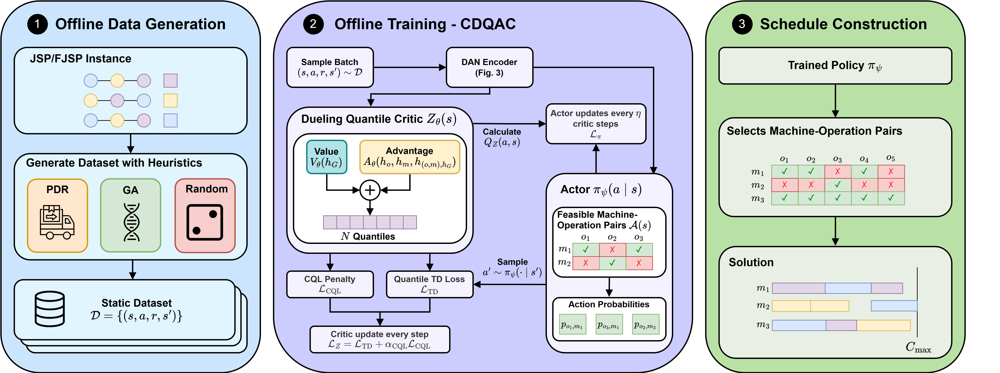

# CDQAC: Offline Reinforcement Learning for Job Shop Scheduling

[](https://jesserem.github.io/cdqac/)
[](https://openreview.net/forum?id=4vVhm4817Q)
[](https://arxiv.org/abs/2509.10303)
[](https://huggingface.co/datasets/jesserem/cdqac_datasets)
[](LICENSE)

Official implementation of **Generalizing Beyond Suboptimality: Offline Reinforcement Learning
Learns Effective Scheduling through Random Solutions** (Jesse van Remmerden, Zaharah Bukhsh,
Yingqian Zhang; TMLR 2026). CDQAC learns JSP and FJSP scheduling policies from a fixed dataset
of schedules, without a simulator during training. See the
[project website](https://jesserem.github.io/cdqac/) for an overview and the results.

<p align="center">
  
</p>

## Installation

```bash
conda create -n cdqac python=3.11
conda activate cdqac
pip install -r requirements.txt
```

For a CUDA build of PyTorch, see the note in `requirements.txt`.

## Quick start

```bash
python download_datasets.py fjsp/sd1_10x5 --sources random          # dataset (~12 MB)
python train.py                                                     # CDQAC, paper default
python eval_model.py checkpoints/<run_folder> --eval_folder ./data/SD1/10x5
```

The replay buffer is kept on disk by default (about 11 GB of temporary files for the paper
default of 500 instances x 100 random schedules); `--use_disk_buffer false` keeps it in RAM
instead (about 15 GB). Use `--num_instances 50` for a quick run.

## Datasets

Datasets are hosted on [Hugging Face](https://huggingface.co/datasets/jesserem/cdqac_datasets)
and downloaded into `train_datasets/`:

```bash
python download_datasets.py                                 # all datasets
python download_datasets.py fjsp/sd1_15x10 --sources random pdr
python -m cdqac.data list                                   # local datasets
python -m cdqac.data info fjsp/sd1_10x5                     # contents of one dataset
```

| dataset id | problem | train / val instances |
|---|---|---|
| `fjsp/sd1_10x5`, `fjsp/sd1_15x10` | FJSP | 1000 (500 used in the paper) / 100 |
| `fjsp/sd1_20x10` | FJSP | 500 / 100 |
| `jsp/taillard_10x5`, `jsp/taillard_15x10` | JSP | 500 / 100 |

Each dataset is a directory of plain NumPy files:

```
train_datasets/fjsp/sd1_10x5/
├── dataset.json        description, generator seeds, checksums
├── train.npz           training instances
├── val.npz             validation instances
└── sources/            one file per source: trajectories (actions) and their makespans
    ├── random.npz      300 random schedules per instance (only 100 are used in the paper)
    ├── pdr.npz         16 dispatching rules (4 for JSP)
    ├── ga_hof.npz      100 genetic-algorithm hall-of-fame schedules
    ├── ga_pop.npz      200 genetic-algorithm population schedules
    └── eps_pdr_0.1.npz, eps_pdr_0.2.npz   dispatching rules with random actions (FJSP only)
```

The file format, adding your own data, generating datasets and the legacy `.npy` files are
described in [`cdqac/data/README.md`](cdqac/data/README.md).

## Training

```bash
python train.py --dataset fjsp/sd1_15x10                    # other dataset
python train.py --use_random false --use_dispatching true   # other source (see table below)
python train.py --method iql                                # a baseline
```

| `--method` | algorithm |
|---|---|
| `cdqac` (default) | CDQAC |
| `bc` | Behavioral Cloning |
| `iql` | Implicit Q-Learning |
| `dmsac`, `mqrdqn` | Offline-LD (maskable SAC / QR-DQN) |
| `td3_awr` | TD3-AWR |

| source | flags |
|---|---|
| random (default) | `--use_random true --n_random 100` |
| dispatching rules | `--use_dispatching true` |
| GA hall of fame / population | `--use_ga_hof true --n_ga_hof N`, `--use_ga_pop true --n_ga_pop N` |
| ε-dispatching rules | `--use_eps_pdr true --eps_pdr_version 0.1` |

Every flag overrides a field of the configs in [`cdqac/configs/`](cdqac/configs/):
`base_config.py` holds the settings all methods share, and each method's file adds its own
hyperparameters. Runs are saved to `checkpoints/<name>_seed_<seed>/` (`config.yml`,
`best_det_offline.pt`, ...).

## Evaluation

```bash
python download_datasets.py checkpoints --no_datasets         # pretrained models

python eval_model.py checkpoints/<run_folder> --eval_folder ./data/SD1/10x5                     # greedy
python eval_model.py checkpoints/<run_folder> --eval_folder ./data/SD1/10x5 --num_samples 100   # best of 100 samples
python eval_model.py checkpoints/fjsp/cdqac/cdqac_random_10_5.pt --eval_folder ./data/BenchData/Brandimarte
```

The evaluation instances are part of the repository, in `data/`: `SD1/` and `SD2/` (generated
FJSP, 10x5 to 40x10), `BenchData/` (Brandimarte, Hurink) and `JSP/` (Taillard, DMU, Lawrence).
Pretrained models are named `checkpoints/<problem>/<method>/<method>_<source>_<size>.pt`.
Results are written to `./results` as one CSV row per instance.

Baselines: `python -m evaluation.eval_dispatching` (dispatching rules),
`python -m evaluation.eval_random` (random policy), `python -m evaluation.ortools_solver`
(OR-Tools CP-SAT).

## Citation

```bibtex
@article{remmerden2026generalizing,
    title={Generalizing Beyond Suboptimality: Offline Reinforcement Learning Learns Effective Scheduling through Random Solutions},
    author={Jesse van Remmerden and Zaharah Bukhsh and Yingqian Zhang},
    journal={Transactions on Machine Learning Research},
    issn={2835-8856},
    year={2026},
    url={https://openreview.net/forum?id=4vVhm4817Q}
}
```
